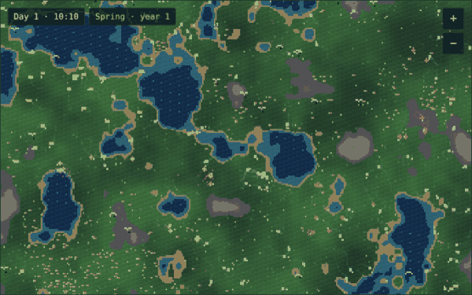

# 🌿 Biosphere

**Your own little world, living in your browser.** Five species of pixel-art creatures, each with a tiny neural-network brain, learn to graze, hunt, scavenge and fly through day and night, seasons, droughts, floods and meteor strikes. Nobody programs their behavior: it evolves.



Every visitor gets their own world. It is saved in the browser and **keeps evolving while you're away**: come back hours later and Biosphere fast-forwards through the time you missed, then tells you what happened.

👉 **[Grow your world](https://riccdev06.github.io/biosphere/)**

## Watch them get smarter

Every creature starts with a random brain. Once a day, Biosphere runs an **intelligence test**: a dozen creatures of each species race creatures with random brains through the same small arenas, and the World tab shows how many times more food they find. In a typical world, herbivores find around 10× more food than random brains after ten days, and predators catch over 10× more prey. You can also test the brain of any single creature.

## Hear them talk

Every creature can make a call that only its own kind hears. Calls cost a little energy and start out meaningless. Biosphere watches who calls and when: if a species starts calling much more when danger is near, an **alarm call** is evolving, and the journal tells you when it happens. Whether a language appears is up to evolution, so every world is a new experiment.

## Five species

| | Species | Eats | Hunted by |
|---|---|---|---|
| 🟦 | **Herbivores** | plants and berries | predators, omnivores |
| 🟥 | **Predators** | herbivores, omnivores (which fight back), carrion | bigger predators push them out of their territory |
| 🟨 | **Omnivores** | plants, small herbivores, carrion | predators |
| 🟪 | **Scavengers** | only carrion, including what predators leave behind | nobody |
| 🩷 | **Flyers** | ripe berries, and they fly over water | nobody |

## What's inside

- **A living planet.** Lakes, meadows, sand and rock generated from a seed on a 640×400 map that wraps around at the edges.
- **Day, night and four seasons.** Plants boom in spring and slow down in winter, so populations rise and crash in real cycles.
- **Climate events.** Droughts dry up the shallow lakes, floods spread the water into the lowlands, blooms cover the land in plants, cold snaps make every step costly, and meteors leave craters that turn into fertile ash.
- **Territory wars.** Big predators drive smaller ones off their hunting grounds.
- **Evolving genes.** Size, speed and sight are inherited and mutate. Bigger bodies store more energy and are harder to hunt; speed and sight burn energy every step.
- **Evolving brains.** Every creature has a recurrent neural network: 16 senses (food, danger, kin, water, energy, memory, calls), 8 hidden neurons and 4 outputs (steer, speed, memory, call). Offspring inherit their parent's brain with small mutations.
- **Thoughts in words.** Under the brain diagram, Biosphere translates what the selected creature senses and does into a plain sentence: "A hunter is to its left. It turns away and runs. It cries out to its kin."
- **Time-lapse.** Biosphere photographs your whole world twice a day, also while you're away, and plays it back as a film of seasons, floods and migrations. On the live site you can save it as a video.
- **Family trees.** Tap a creature to see its ancestors, children and grandchildren, and how many living descendants it has.
- **Champions.** Export your best creature as a code and send it to a friend. In their world it arrives with five offspring, so worlds can challenge each other.
- **Ambient sound.** Birdsong by day, crickets at night, rain and wind, all synthesized in the browser. Off by default.
- **Play god.** Scatter plants, release any species, or call down a meteor.
- **Postcards.** Turn your world into a picture with its day, season and smartest species, ready to share.
- **A short guide** on your first visit, and anytime from the ? button.

## While you're away

Your world is stored in `localStorage`. When you come back, the simulation replays the time you missed in the background while you watch it fast-forward: one step per second away for the first 6 hours, then one step every 3 seconds, up to 15 world days. On slower devices it stops after about 30 seconds and tells you how much it replayed. Then you get a summary of births, deaths, extinctions, climate events and how far each species evolved.

The world lives in one browser: your phone and your computer each have their own.

## Share a world

Every world grows from a code like `quiet-swamp-37`. Same code, same land and same first creatures:

```
https://riccdev06.github.io/biosphere/#quiet-swamp-37
```

## Run it locally

No build step and no dependencies, but ES modules and workers need a local server:

```bash
python3 -m http.server
# then open http://localhost:8000
```

## Tests

```bash
npm test
```

The tests use Node's built-in runner and need no installs. They check that worlds are reproducible, saves load back, champions travel, and that after four days evolved brains beat random ones without the ecosystem falling apart.

## Project structure

```
index.html        page layout
css/style.css     styles
js/sim.js         simulation engine (no DOM, also runs in Node)
js/worker.js      runs the simulation in a background thread
js/render.js      pixel renderer, camera, weather and effects
js/charts.js      brain diagram and charts
js/audio.js       synthesized ambient sound
js/storage.js     saving your world in localStorage
js/timelapse.js   time-lapse pictures (IndexedDB) and the film player
js/main.js        interface, guide, postcard and controls
test/             tests for the simulation
```

## Contributing

Ideas and pull requests are welcome. Read [CONTRIBUTING.md](CONTRIBUTING.md) for how the code fits together, then pick an [open issue](https://github.com/riccdev06/biosphere/issues), for example one labelled **good first issue**.

## License

MIT
